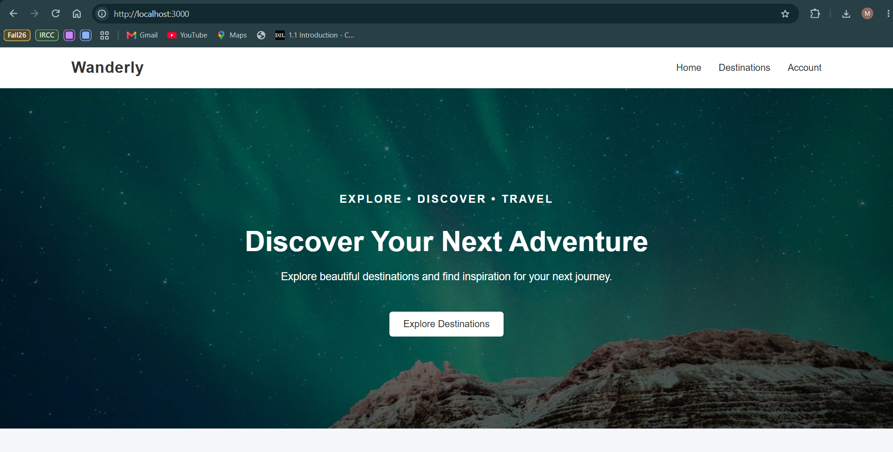
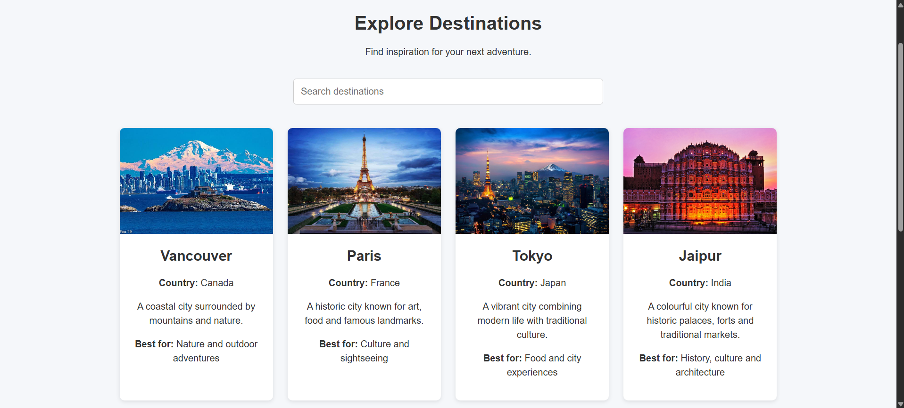
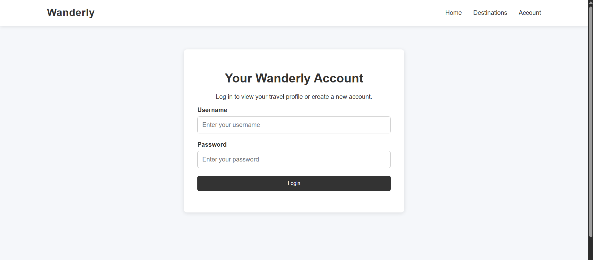
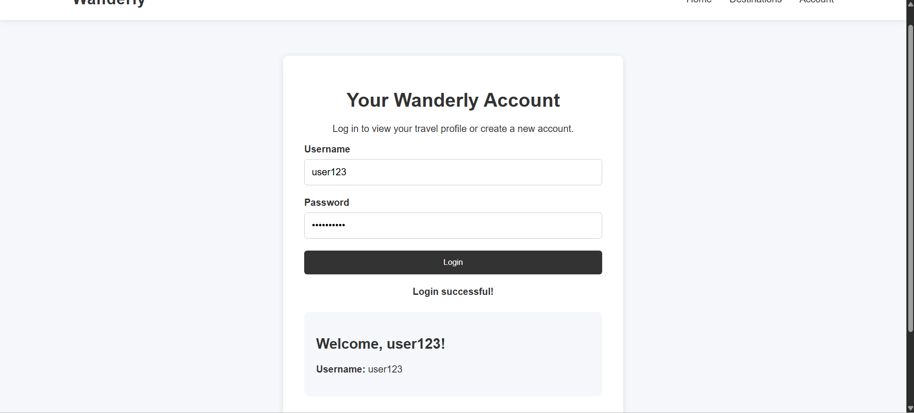

# 🌍 Wanderly – Travel Discovery Web Application

Wanderly is a full-stack travel discovery web application designed to help users explore destinations around the world through an interactive and user-friendly interface.

Built using AngularJS, Node.js, Express.js, and MongoDB, the project demonstrates full-stack web development, frontend-backend integration, RESTful APIs, and database management.

## ✨ Features

- 🌎 **Destination Exploration** – Browse travel destinations through an interactive interface.
- 🔍 **Destination Search** – Discover destinations based on user interests.
- 👤 **User Registration** – Create user accounts through a registration interface.
- 🔐 **User Login** – Sign in using registered account credentials.
- 🗄️ **Database Integration** – Store and retrieve user information using MongoDB.
- 📱 **Responsive Design** – User-friendly layouts across different screen sizes.
- 🔗 **RESTful API Integration** – Communication between the frontend and backend using Express.js.


## 📸 Application Screenshots

### 🏠 Homepage
Explore Wanderly's welcoming homepage and discover your next adventure.



### 🌍 Explore Destinations
Browse travel destinations through an interactive interface.



### 🔐 User Login
Sign in to access your Wanderly account.



### 👤 User Registration
Create an account to get started with Wanderly.




## 🛠️ Tech Stack

| Category | Technologies |
|----------|-------------|
| Frontend | HTML5, CSS3, JavaScript, AngularJS |
| Backend | Node.js, Express.js |
| Database | MongoDB |
| API | RESTful APIs |
| Development Tools | Visual Studio Code, npm, Git, GitHub |

## 📂 Project Structure

```text
Wanderly/
│
├── images/              # Website images and assets
├── index.html           # Homepage
├── destinations.html    # Destination exploration page
├── destinations.js      # Destination functionality
├── account.html         # User account interface
├── app.js               # Frontend application logic
├── users.js             # User-related functionality
├── server.js            # Express backend server
├── style.css            # Website styling
├── package.json         # Project dependencies
├── package-lock.json    # Dependency lock file
├── .gitignore           # Git exclusions
└── README.md            # Project documentation
```

## 🚀 Getting Started

### Prerequisites

Make sure you have the following installed:

- Node.js
- npm
- MongoDB
- Git
- A modern web browser

### Installation

**1. Clone the repository**

```bash
git clone https://github.com/Manvi0103/Wanderly.git
```

**2. Navigate to the project directory**

```bash
cd Wanderly
```

**3. Install dependencies**

```bash
npm install
```

**4. Configure MongoDB**

Ensure MongoDB is running and configure the database connection in the backend as required.

**5. Start the application**

```bash
node server.js
```

**6. Open the application**

Open your browser and navigate to the local address and port configured in `server.js`.

## 🧠 What I Learned

Through developing Wanderly, I gained practical experience in:

- Building interactive web interfaces using AngularJS.
- Developing backend functionality with Node.js and Express.js.
- Integrating MongoDB for data storage and retrieval.
- Creating RESTful APIs for frontend-backend communication.
- Implementing user registration and login workflows.
- Organizing and maintaining a full-stack web application.
- Using Git and GitHub for version control.

## 🔮 Future Improvements

- Implement secure password hashing and enhanced authentication.
- Add personalized destination recommendations.
- Integrate travel and weather APIs.
- Introduce user reviews and destination ratings.
- Add bookmarking and favorite destinations.
- Improve accessibility and mobile responsiveness.
- Deploy the application to a cloud hosting platform.

## 👩‍💻 Author

**Manvi Aggarwal**

Bachelor of Computer Science  
Dalhousie University

GitHub: [@Manvi0103](https://github.com/Manvi0103)

## 📄 Project Information

This project demonstrates the design and development of a full-stack web application using modern web technologies.
